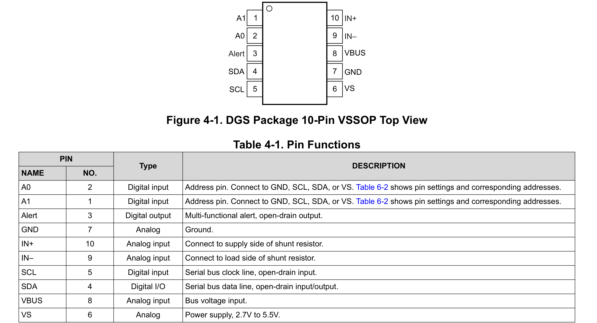
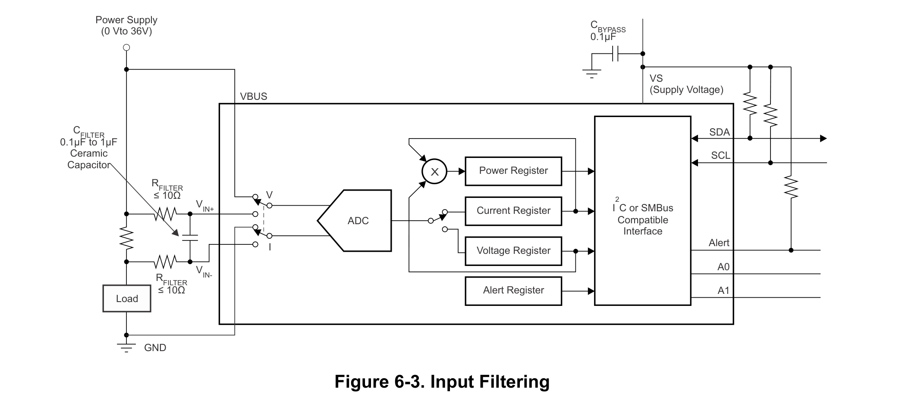
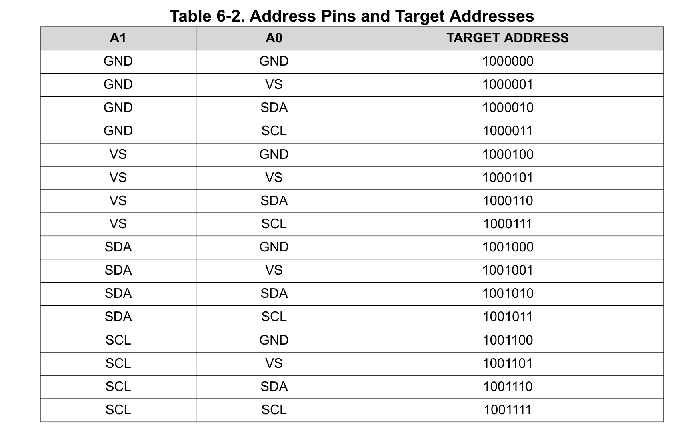

# Reference — INA226

**Datasheet:** TI *INA226*, ZHCS078C / SBOS547C (revised August 2026) — `Datasheet/ina226.pdf` . Figures are cropped from the identical English edition; table and figure numbers match.

---

## 1. Hardware

### 1.1 Pins — Table 4-1 (p.3)

|  Pin | Symbol | Net on D3a | Note |
| ---: | ------ | ---------- | ---- |
|    1 | A1     | GND        | address |
|    2 | A0     | GND        | address |
|    3 | Alert  | NC         | open-drain; may float if unused |
|    4 | SDA    | `SDA`      | 2.2 kΩ pull-up on D3b |
|    5 | SCL    | `SCL`      | 2.2 kΩ pull-up on D3b |
|    6 | VS     | `+3V3`     | `C30` 100 nF |
|    7 | GND    | GND        | |
|    8 | VBUS   | `+5V_PI`   | load side of `R20` |
|    9 | IN−    | `INA_INN`  | via `R39` 10 Ω to `R20` |
|   10 | IN+    | `INA_INP`  | via `R38` 10 Ω to `R20` |

### 1.2 Design decisions — Fig 6-3 (p.14), §6.4.2 (p.13), §8.3–8.4 (p.29)

| Item | Datasheet | Used | Why |
|---|---|---|---|
| Address | Table 6-2 (p.17): A1, A0 to GND/VS/SDA/SCL → 16 addresses | **A1 = A0 = GND** | `1000000` = **0x40**; static pins, no resistors |
| Shunt | ±81.92 mV, 2.5 µV/LSB (§7.1.2) | `R20` **5 mΩ** 1 % | 4 A → **20 mV** (24 % FS), 0.08 W; raw LSB = **0.5 mA**; FS ±16.38 A |
| Bus voltage | 0–36 V, 1.25 mV/LSB, 830 kΩ (§5.5) | VBUS → `+5V_PI` | load-side voltage; power register reports power to the Pi, shunt loss excluded |
| Input filter | §6.4.2: 10 Ω in each input protects to 40 V when one side lacks bulk capacitance; Fig 6-3: R ≤ 10 Ω, C = 0.1–1 µF | `R38`/`R39` **10 Ω**, `C31` **100 nF** | `C20` 470 µF is only on the load side. Resistors carry no load current; fc ≈ 80 kHz; IB 0.1 nA → 2 nV |
| Kelvin sense | §8.4.1: 4-wire connection at the shunt | `R38`/`R39` from **`R20` pads** | 5 mΩ: any shared trace resistance becomes a large error |
| VS bypass | §8.3: 0.1 µF close to VS/GND | `C30` **100 nF** at pins 6/7 | D3a `+3V3` had no local capacitor |
| Alert | p.12: may float if unused; §8.2.1.2: pull up to VS if used | **NC** | `0x06 = 0x0000` |
| Absolute max | diff ±40 V; CM −0.3–40 V; VBUS −0.3–40 V; VS 6 V (§5.1) | 5 V rail | inputs survive 0–36 V with VS off (§8.3) |

---

## 2. Software interface

### 2.1 Address and bus

| Item | Value |
|---|---|
| 7-bit address | **0x40** (write 0x80, read 0x81) |
| Master | L1 Pi I²C1 — GPIO2 = SDA, GPIO3 = SCL |
| Speed | up to 400 kHz |
| Pull-ups | 2.2 kΩ to +3V3, on D3b only (`R27`/`R28`) |
| Byte order | MSB first; write the register pointer before each access |
| SMBus timeout | 28–35 ms (SCL low); the interface resets after that |

### 2.2 Registers — Table 7-1 (p.21)

| Pointer | Register | Access | Reset | Scale |
| ---: | --- | --- | --- | --- |
| 0x00 | Configuration | R/W | 0x4127 | see §2.3 |
| 0x01 | Shunt voltage | R | 0x0000 | 2.5 µV/LSB, signed |
| 0x02 | Bus voltage | R | 0x0000 | 1.25 mV/LSB, unsigned |
| 0x03 | Power | R | 0x0000 | 25 × Current_LSB |
| 0x04 | Current | R | 0x0000 | Current_LSB, signed |
| 0x05 | Calibration | R/W | 0x0000 | |
| 0x06 | Mask/Enable | R/W | 0x0000 | not used |
| 0x07 | Alert limit | R/W | 0x0000 | not used |
| 0xFE | Manufacturer ID | R | 0x5449 | "TI" |
| 0xFF | Die ID | R | 0x2260 / 0x2261 | |

Current and power read 0 until `0x05` is written (Table 7-1, note 2).

### 2.3 Configuration and calibration — Tables 7-2…7-6 (p.21–23), §6.5 (p.14)

| Field | Bits | Value used |
|---|---|---|
| AVG | D11–D9 | `010` = 16 samples |
| VBUSCT | D8–D6 | `100` = 1.1 ms |
| VSHCT | D5–D3 | `100` = 1.1 ms |
| MODE | D2–D0 | `111` = shunt + bus, continuous |

Configuration = **0x4527** (default 0x4127; fast option 0x4007 = 1 sample, 140 µs, 280 µs update). D14 is reserved and reads 1.

`Current_LSB = max current / 2^15`; `CAL = 0.00512 / (Current_LSB × R_SHUNT)`.

- Current_LSB = 4 A / 2^15 = 122 µA → choose **0.5 mA** (= raw LSB: 2.5 µV / 5 mΩ)
- CAL = 0.00512 / (0.5 mA × 5 mΩ) = **2048 = 0x0800**
- Power_LSB = 25 × 0.5 mA = **12.5 mW**
- At 4 A / 5 V: shunt 8000, current 8000, bus 4000, power 1600

### 2.4 Initialisation

1. Optional: read `0xFE` = 0x5449 and `0xFF` = 0x2260/0x2261.
2. `0x00 ← 0x4527`.
3. `0x05 ← 0x0800`.
4. Wait ≥ 35.2 ms (16 × 2.2 ms).
5. Read `0x02`, `0x04`, `0x03`. Shunt and current are two's complement; bus and power are unsigned.
