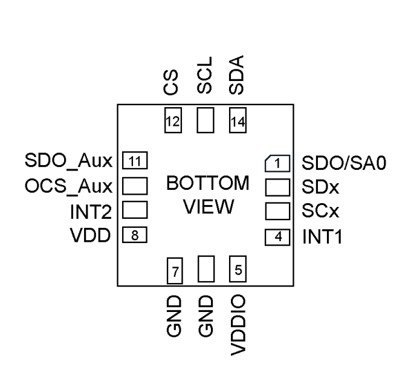
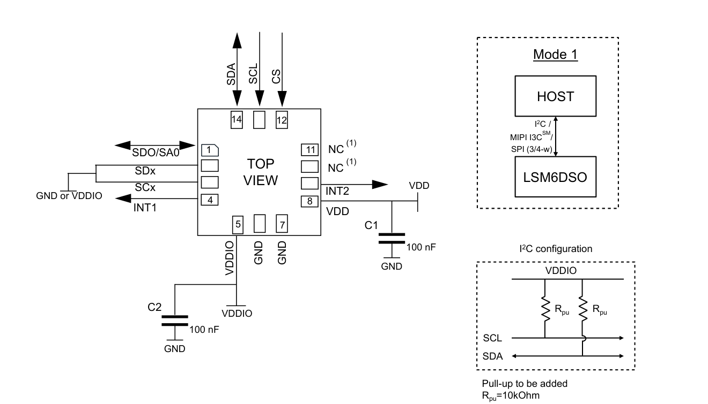
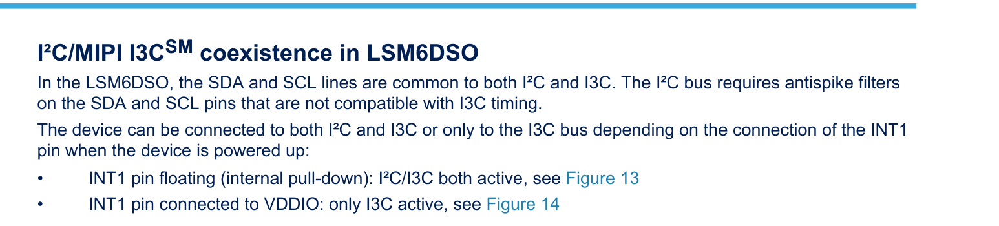

# Reference — LSM6DSO

**Datasheet:** ST *LSM6DSO — 6-axis IMU (inertial measurement unit)*, DS12140 Rev 3 (June 2024) — `Datasheet/LSM6DSOETR3.pdf`

---

## 1. Hardware

### 1.1 Pins — Figure 3 (p.6), Table 1 (p.8)



| Pin | Name | Net on D3b | Note |
| ---: | ---- | ---------- | ---- |
| 1 | SDO/SA0 | GND | I²C address LSb = 0 → **0x6A** |
| 2 | SDx | GND | Mode 1: must be VDDIO or GND |
| 3 | SCx | GND | Mode 1: must be VDDIO or GND |
| 4 | INT1 | `IMU_INT` | programmable interrupt; **must be low at power-up**; routed to `J_PI.11` / GPIO17 (§1.3) |
| 5 | VDDIO | `+3V3` | `C29` 100 nF to GND |
| 6 | GND | GND | |
| 7 | GND | GND | |
| 8 | VDD | `+3V3` | `C28` 100 nF to GND |
| 9 | INT2 | NC | Mode 1: output forced low by default; unused |
| 10 | OCS_Aux | NC | Mode 1: **leave unconnected** |
| 11 | SDO_Aux | NC | Mode 1: VDDIO or unconnected |
| 12 | CS | `+3V3` | high = I²C enabled |
| 13 | SCL | `SCL` | external pull-up |
| 14 | SDA | `SDA` | external pull-up |

Only **Mode 1** (I²C/SPI) is used. Mode 2 is the sensor-hub master; Mode 3/4 are the auxiliary SPI/OIS interface.

### 1.2 Design decisions — Table 1 (p.8), §5.1 (p.16), Figure 21 (p.34)



| Item | Datasheet | Used | Why |
|---|---|---|---|
| Supply | VDD **1.71–3.6 V**; VDDIO **1.62–3.6 V** (Table 3, p.11) | **3.3 V** on both | within range |
| Interface | CS high = I²C enabled; Mode 1 SDx/SCx = VDDIO **or GND** (Table 1) | **I²C**, `CS` = +3V3, SDx/SCx = GND | 4-wire SPI not needed; GND is allowed |
| Address | SDO/SA0 = 0 → `1101010` = **0x6A** (Table 10, p.17) | SDO/SA0 = GND | leaves 0x6B free |
| I²C speed | fast mode **400 kHz** max (Table 6, p.13) | **400 kHz** | Pi I²C1 |
| Pull-ups | external to VDDIO; Figure 21 example **R_pu = 10 kΩ** | `R27`/`R28` **2.2 kΩ** + Pi 5 1.8 kΩ | effective ≈ 0.99 kΩ; see note |
| Decoupling | 100 nF on VDD and VDDIO (Table 1 note 1; Figure 21 C1/C2) | **`C28`** (VDD), **`C29`** (VDDIO) | one per supply pin, close to pins 8/5 |
| INT1 | programmable; **push-pull, active high** by default (CTRL3_C = 0x04; Table 50, p.51) | **`IMU_INT` → Pi GPIO17** | data-ready; optional; GPIO9–27 resets low |
| INT2 | Mode 1: output forced to ground (Table 19, p.37) | NC | not used |
| OCS_Aux | Mode 1: leave unconnected (Table 1) | NC | required |
| SDO_Aux | Mode 1: VDDIO or unconnected (Table 1) | NC | allowed; internal pull-up |
| Current | 0.55 mA combo high-performance; 3 µA power-down (Table 3) | — | negligible on the 3.3 V rail |
| Package | LGA-14L, 2.5 × 3 × 0.83 mm (p.1) | — | |

### 1.3 Checks and notes

**No connection error found.** Pinout, Mode 1 strapping, address, CS level, decoupling and the NC pins all match DS12140.

#### ⚠️ INT1 must be low at power-up — resolved

DS12140 §5.3 (p.24):



- INT1 **floating** (internal pull-down): I²C **and** I3C active.
- INT1 **connected to VDDIO**: **only I3C active**.

Table 19 note 2 (p.38) is explicit: **“INT1 must be set to 0 or left unconnected during power-on if the I²C/SPI interfaces are used.”**

On Raspberry Pi 5 (RP1), GPIO0–GPIO8 reset as inputs with **pull-ups** enabled; **GPIO9–27 reset with pull-downs**. RP1's in-pad pulls are about **50 kΩ** (programmable). The original `IMU_INT` on GPIO4 therefore saw a high through the Pi pull-up at power-up and could make the LSM6DSO come up **I3C-only**.

**Chosen fix (2026-11-01):** move `IMU_INT` from `J_PI.7` (GPIO4) to **`J_PI.11` (GPIO17)**. GPIO17 is in the GPIO9–27 group and resets low, so `U5.4` is low at power-up with **no external resistor**.

- `J_PI.7` (GPIO4) is now **NC**; do not reassign it without checking its reset pull-up.
- **No `R37`**; BOM unchanged.
- This changes the D3a netlist (`IMU_INT` now on `J_PI.11`); the D3b netlist is unchanged (`U5.4` still `IMU_INT`).
- If the interrupt is moved again, keep it in GPIO9–27 or add a pull-down.

> Note: GPIO4 is also the Pi's default **1-Wire** pin and is not 5 V tolerant. It is now unused; if it is ever reassigned, keep 1-Wire disabled.
>
> Note: GPIO17 is also **SPI1_CE1** on the 40-pin header. Keep SPI1 disabled while GPIO17 is used for `IMU_INT` (the board uses SPI0 for the MCP2515).

#### I²C pull-ups

The Pi 5 has fixed **1.8 kΩ** pull-ups on GPIO2/3 (SDA/SCL). The board adds `R27`/`R28` **2.2 kΩ** to +3V3, so the effective pull-up is:

```
1 / (1/1.8k + 1/2.2k) = 0.99 kΩ
```

The LSM6DSO can sink 4 mA (3.1 mA at 0.99 kΩ), so it is within spec. The PCA9554A and INA226 guarantee V_OL = 0.4 V at 3 mA; at 3.1 mA the low level is only slightly higher and is still far below V_IL(max) = 0.99 V. This is **not a connection error**. The practical check is rise time: with 0.99 kΩ, fast-mode 300 ns allows about **140 pF** of bus capacitance; a short stack bus should be well below that. If there are bus errors, remove `R27`/`R28` (the Pi's 1.8 kΩ alone is enough) or change them to 10 kΩ (effective 1.53 kΩ). The datasheet's example is 10 kΩ.

#### Other notes

- `C28`/`C29` 100 nF are the required local bypass; no local bulk capacitor is required. `C27` 10 µF is the board-level bulk at U1.
- `OCS_Aux` has an internal pull-up in Mode 1 but **must be left electrically unconnected**; do not tie it to VDDIO.
- `SDO_Aux` has an internal pull-up and may be left unconnected in Mode 1.
- Confirm the **LSM6DSOETR3** order code at purchase; the datasheet covers the LSM6DSO family, and the distributor code adds a reel/packing suffix.

### 1.4 Bring-up checks

1. Power: `U5.8` (VDD) = `U5.5` (VDDIO) = **3.3 V**; `C28`/`C29` close to the pins.
2. **At power-up:** measure `U5.4` (INT1). With `IMU_INT` on GPIO17 it should be near **0 V** (GPIO9–27 reset pull-down); it must be < **0.99 V**. If it is near 3.3 V, the device may not answer on I²C.
3. `i2cdetect -y 1` should show **0x6A**; read `WHO_AM_I` (0x0F) = **0x6C**.
4. Read/write `CTRL3_C` (0x12); set `BDU` = 1 if consistent reads are needed.
5. Configure `CTRL1_XL` (0x10) and `CTRL2_G` (0x11); read `OUTX_L_A` (0x28) and `OUTX_L_G` (0x22); check all axes.
6. Data-ready: write `INT1_CTRL` (0x0D) = **0x03** (XL + G data-ready); observe `IMU_INT` toggling at the configured ODR.
7. If there is no ACK: check INT1 low at power-up, CS high, SDO/SA0 low, VDD/VDDIO, and SDA/SCL pull-ups.

---

## 2. Interface

### 2.1 I²C address and timing — §5.1.1 (p.16–17), Table 6 (p.13)

| Item | Value |
|---|---|
| 7-bit address | **0x6A** (SDO/SA0 = 0) |
| Write byte | **0xD4** |
| Read byte | **0xD5** |
| Max clock | **400 kHz** (fast mode) |
| WHO_AM_I (0x0F) | **0x6C** |
| Auto-increment | `CTRL3_C.IF_INC` = 1 by default |

The device is a bus slave. A read uses `START → SAD+W → SUB → repeated START → SAD+R → data → NACK → STOP` (Table 13/14).

### 2.2 Mode 1 strapping — Table 1 (p.8), Table 19 (p.37–38)

| Pin | Setting on D3b | Effect |
|---|---|---|
| `CS` (12) | **high** (+3V3) | I²C enabled; SPI disabled |
| `SDO/SA0` (1) | **low** (GND) | address 0x6A |
| `SDx` (2), `SCx` (3) | **GND** | Mode 1: allowed (VDDIO or GND) |
| `INT1` (4) | **low at power-up** | I²C + I3C active; high = I3C only |
| `INT2` (9) | NC | default output forced low |
| `OCS_Aux` (10) | NC | must be unconnected in Mode 1 |
| `SDO_Aux` (11) | NC | allowed in Mode 1 |

### 2.3 INT1 routing — §9.12 (p.47), §9.14 (p.51)

- Default output: **push-pull, active high** (`CTRL3_C.PP_OD` = 0, `H_LACTIVE` = 0).
- `INT1_CTRL` (0x0D): bit 0 = accelerometer data-ready, bit 1 = gyroscope data-ready; **0x03** enables both.
- `MD1_CFG` (0x5E) routes wake-up, free-fall, tap, 6D/4D and other functions to INT1; `INT1_CTRL` and `MD1_CFG` are OR-ed.
- Keep **push-pull / active high** (the board does not fit an external pull-down). If open-drain / active-low were selected, the line would need a pull-up and the interrupt polarity would invert.

### 2.4 Register quick reference — Table 20 (p.39–40)

| Register | Address | Use |
|---|---:|---|
| `INT1_CTRL` | 0x0D | route data-ready / FIFO / boot to INT1 |
| `INT2_CTRL` | 0x0E | route signals to INT2 (NC here) |
| `WHO_AM_I` | 0x0F | fixed **0x6C** |
| `CTRL1_XL` | 0x10 | accelerometer ODR / full scale / filter |
| `CTRL2_G` | 0x11 | gyroscope ODR / full scale / filter |
| `CTRL3_C` | 0x12 | BDU, H_LACTIVE, PP_OD, IF_INC, SW_RESET |
| `STATUS_REG` | 0x1E | XLDA / GDA data-ready flags |
| `OUT_TEMP_L` | 0x20 | temperature |
| `OUTX_L_G` | 0x22 | gyroscope X…Z (0x22–0x27) |
| `OUTX_L_A` | 0x28 | accelerometer X…Z (0x28–0x2D) |
| `MD1_CFG` | 0x5E | interrupt functions on INT1 |

`CTRL1_XL` and `CTRL2_G` reset to **0x00** (power-down). The ODR/full-scale values depend on the application; set them explicitly.

Minimal probe sequence:

```
read  0x0F              -> 0x6C
write 0x12 = 0x44       -> BDU=1, IF_INC=1
write 0x10 = <ODR/FS>   -> accelerometer on
write 0x11 = <ODR/FS>   -> gyroscope on
write 0x0D = 0x03       -> XL/G data-ready on INT1
read  0x28..0x2D        -> accelerometer
read  0x22..0x27        -> gyroscope
```

### 2.5 Pi 5 side

| Signal | Pi pin | GPIO | Note |
|---|---:|---:|---|
| `SDA` | 3 | GPIO2 | fixed **1.8 kΩ** board pull-up |
| `SCL` | 5 | GPIO3 | fixed **1.8 kΩ** board pull-up |
| `IMU_INT` | 11 | GPIO17 | GPIO9–27 reset with pull-down; **low at power-up**; no external resistor |
| — | 7 | GPIO4 | **NC**; GPIO0–8 reset with pull-up, so not reused for INT1 |

**Pi 5 GPIO reset references:** [Raspberry Pi Forums — Pi5 GPIO Reset Defaults](https://forums.raspberrypi.com/viewtopic.php?p=2200108), [pinout.xyz — GPIO](https://pinout.xyz/pinout/gpio).
