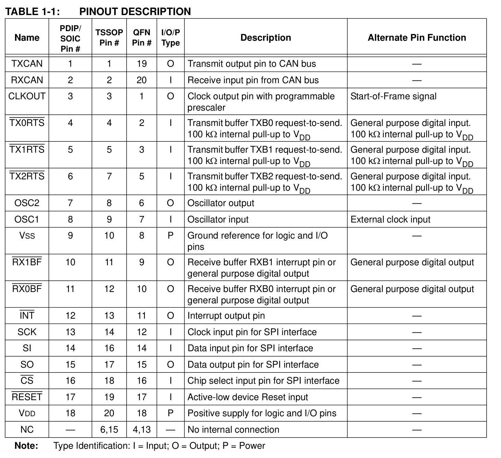
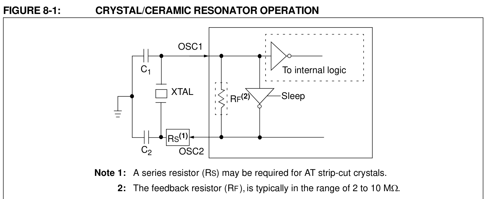
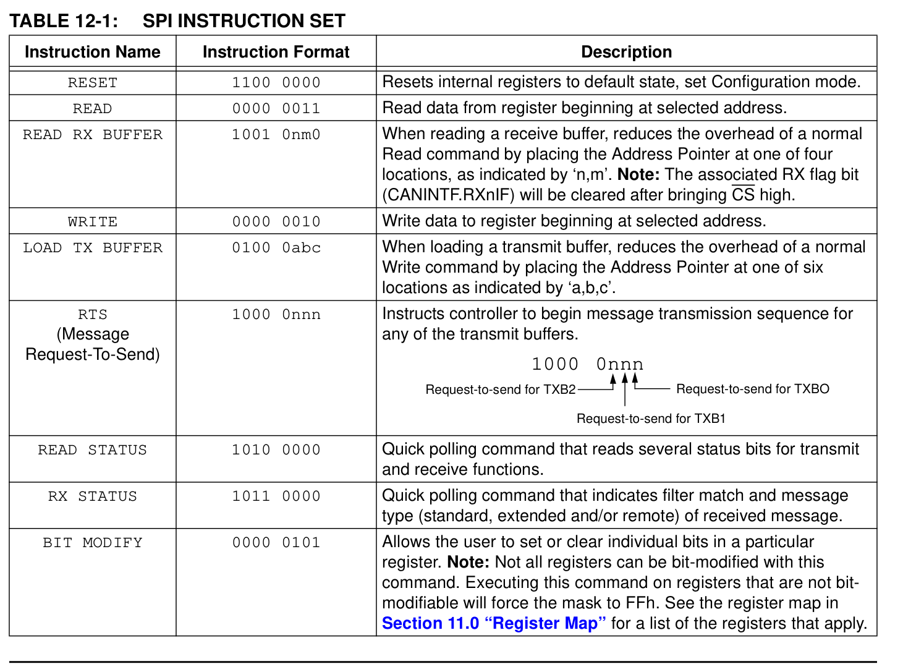

# Reference — MCP2515

**Datasheet:** Microchip *MCP2515 — Stand-Alone CAN Controller with SPI Interface*, DS21801G (2003–2012) — `Datasheet/MCP2515.pdf`

---

## 1. Hardware

### 1.1 Pins — Table 1-1 (p.4)

SOIC-18 uses the **PDIP/SOIC** column; the TSSOP-20 and QFN-20 pin numbers are different.

|  Pin | Symbol     | Net on D3b  | Note |
| ---: | ---------- | ----------- | ---- |
|    1 | TXCAN      | `CAN_TXD`   | → `U2.1` (SN65HVD230 D) |
|    2 | RXCAN      | `CAN_RXD`   | ← `U2.4` (R); V_IH = 2.0 V |
|    3 | CLKOUT/SOF | NC          | active after reset at FOSC/8 = 1 MHz; firmware sets CLKEN = 0 |
|    4 | TX0RTS     | NC          | 100 kΩ internal pull-up |
|    5 | TX1RTS     | NC          | 100 kΩ internal pull-up |
|    6 | TX2RTS     | NC          | 100 kΩ internal pull-up |
|    7 | OSC2       | `OSC2`      | `Y1` 8 MHz + `C23` 22 pF |
|    8 | OSC1       | `OSC1`      | `Y1` 8 MHz + `C22` 22 pF |
|    9 | VSS        | GND         | |
|   10 | RX1BF      | NC          | high-Z after reset (BFPCTRL = 0x00) |
|   11 | RX0BF      | NC          | high-Z after reset |
|   12 | INT        | `CAN_INT`   | push-pull; `R25` 4.7 kΩ to +3V3 |
|   13 | SCK        | `SPI_SCK`   | ← Pi GPIO11 |
|   14 | SI         | `SPI_MOSI`  | ← Pi GPIO10 |
|   15 | SO         | `SPI_MISO`  | → Pi GPIO9 |
|   16 | CS         | `SPI_CS`    | ← Pi GPIO8 |
|   17 | RESET      | `CAN_RST`   | `R26` 10 kΩ to +3V3; Pi GPIO24 |
|   18 | VDD        | `+3V3`      | `C25` 100 nF + `C27` 10 µF |

### 1.2 Design decisions — Fig 8-1 (p.55), §9 (p.57), Tables 13-1/13-2/13-4/13-6

| Item | Datasheet | Used | Why |
|---|---|---|---|
| Supply | VDD 2.7–5.5 V; FOSC ≤ 25 MHz over 2.7–5.5 V (Tables 13-1, 13-2) | **3.3 V, 8 MHz** | 8 MHz gives 8 TQ/bit at 500 kbit/s |
| Crystal | parallel cut required; 8 MHz → C1 = C2 = 22 pF (Table 8-2); RF = 2–10 MΩ is inside the oscillator (Fig 8-1) | `Y1` 8 MHz, `C22`/`C23` **22 pF** | no external RF; series RS only for AT strip-cut crystals |
| SPI clock | 10 MHz max (Table 13-6) | Pi SPI ≤ 8 MHz | modes 0,0 and 1,1 |
| Logic levels | SCK/CS/SI V_IH = 0.7 VDD = 2.31 V; RESET V_IH = 0.85 VDD = 2.81 V (Table 13-1) | direct to Pi 3.3 V | high level 3.3 V |
| TXnRTS | 100 kΩ internal pull-up (§3.5) | NC | no external resistors |
| RXnBF | high-Z when BFPCTRL.BnBFE = 0 (Table 4-1) | NC | BFPCTRL reset value = 0x00 |
| INT | push-pull output (Table 1-1 type O; V_OH tested in Table 13-1) | `R25` 4.7 kΩ to +3V3 | pull-up not required; defines the level while U1 is in reset |
| RESET | low ≥ 2 µs (Table 13-4); a reset after power-up is required (§9) | `R26` 10 kΩ + Pi GPIO24 | firmware also sends SPI RESET 0xC0 |
| CLKOUT | enabled after reset at FOSC/8 (§8.2; CANCTRL POR = 0xE7) | NC | firmware disables it (CLKEN = 0) |
| Decoupling | — | `C25` 100 nF + `C27` 10 µF | per-IC bypass (`10` §7.6) |

---

## 2. Software interface

### 2.1 SPI — §12.1, Table 12-1 (p.66)

| Item | Value |
|---|---|
| Mode | 0,0 or 1,1 |
| Max clock | 10 MHz |
| Data | SI sampled on rising SCK; SO driven on falling SCK |
| CS | low for the whole command; must rise between commands |
| Address pointer | auto-increments on READ and WRITE |

| Command | Byte(s) | Use |
|---|---|---|
| RESET | `C0` | reset registers, enter Configuration mode |
| READ | `03` + addr | read, pointer auto-increments |
| READ RX BUFFER | `90`/`92` (RXB0 SIDH/D0), `94`/`96` (RXB1) | read a receive buffer; RXnIF clears when CS rises |
| WRITE | `02` + addr + data | write, pointer auto-increments |
| LOAD TX BUFFER | `40`/`42` (TXB0), `44`/`46` (TXB1), `48`/`4A` (TXB2) | load ID or data |
| RTS | `80` \| nnn | request transmission of TXB0/1/2 |
| READ STATUS | `A0` | poll RX/TX status bits |
| RX STATUS | `B0` | filter match and frame type |
| BIT MODIFY | `05` + addr + mask + data | set/clear individual bits |

### 2.2 Modes and registers — §10, Tables 11-1/11-2 (p.63)

| REQOP<2:0> | Mode |
|---|---|
| `000` | Normal |
| `001` | Sleep |
| `010` | Loopback |
| `011` | Listen-only |
| `100` | Configuration — the only mode where CNF1/2/3, TXRTSCTRL, filters and masks are writable |

`CANCTRL` = 0x0F, `CANSTAT` = 0x0E; after requesting a mode change, verify `CANSTAT.OPMODE`. Configuration mode is selected after power-up or reset.

| Address | Register | Note |
|---:|---|---|
| 0x0C | BFPCTRL | RXnBF control; 0x00 = disabled |
| 0x0D | TXRTSCTRL | TXnRTS pin configuration |
| 0x0E | CANSTAT | OPMODE, ICOD |
| 0x0F | CANCTRL | REQOP, ABAT, OSM, CLKEN, CLKPRE; POR = 0xE7 |
| 0x1C / 0x1D | TEC / REC | error counters |
| 0x28–0x2A | CNF3 / CNF2 / CNF1 | bit timing |
| 0x2B / 0x2C / 0x2D | CANINTE / CANINTF / EFLG | interrupt enables, flags, error flags |
| 0x30 / 0x40 / 0x50 | TXB0 / TXB1 / TXB2 | 14 bytes each |
| 0x60 / 0x70 | RXB0 / RXB1 | 14 bytes each |

RX filters are at 0x00–0x0B and 0x10–0x1B; masks RXM0/RXM1 at 0x20–0x27.

### 2.3 Bit timing — §5.5 (p.43–45)

- `TQ = 2 × (BRP + 1) / FOSC`
- Bit time = Sync (1 TQ) + Prop (PRSEG + 1) + PS1 (PHSEG1 + 1) + PS2 (PHSEG2 + 1)
- PS2 ≥ 2 TQ; PropSeg + PS1 ≥ PS2; SJW = 1–4 TQ

8 MHz, 500 kbit/s — **CNF1 = 0x00, CNF2 = 0x90, CNF3 = 0x02**:

| Field | Value | Length |
|---|---|---|
| BRP | 0 | TQ = 250 ns; 8 TQ per bit |
| SJW | 1 TQ | — |
| PropSeg | 1 TQ | PRSEG = 0 |
| PS1 | 3 TQ | PHSEG1 = 2 |
| PS2 | 3 TQ | PHSEG2 = 2 |

Sample point = 5/8 = **62.5 %** (within the 60–70 % Microchip guidance, §5.3). The highest sample point possible at 8 MHz is 75 %: CNF2 = 0x98, CNF3 = 0x01 (PS1 = 4, PS2 = 2).

### 2.4 Initialisation

1. After VDD, wait for the Oscillator Start-up Timer: 128 OSC1 cycles = **16 µs** at 8 MHz (§8.1); no SPI before that.
2. Reset: drive `CAN_RST` low for ≥ 2 µs, or send SPI `C0`. The device ends in Configuration mode.
3. Write `CNF3 = 0x02`, `CNF2 = 0x90`, `CNF1 = 0x00`; `TXRTSCTRL = 0x00`; `BFPCTRL = 0x00`.
4. Program masks and filters (reset value 0x00 accepts all messages).
5. Clear `CANINTF`; enable the required interrupts in `CANINTE`.
6. Write `CANCTRL = 0x00` — REQOP = 000 (Normal), CLKEN = 0 (CLKOUT off). Verify `CANSTAT.OPMODE = 000`.
7. Transmit: LOAD TX BUFFER, then RTS. Receive: READ RX BUFFER; raising CS clears the RXnIF flag.
