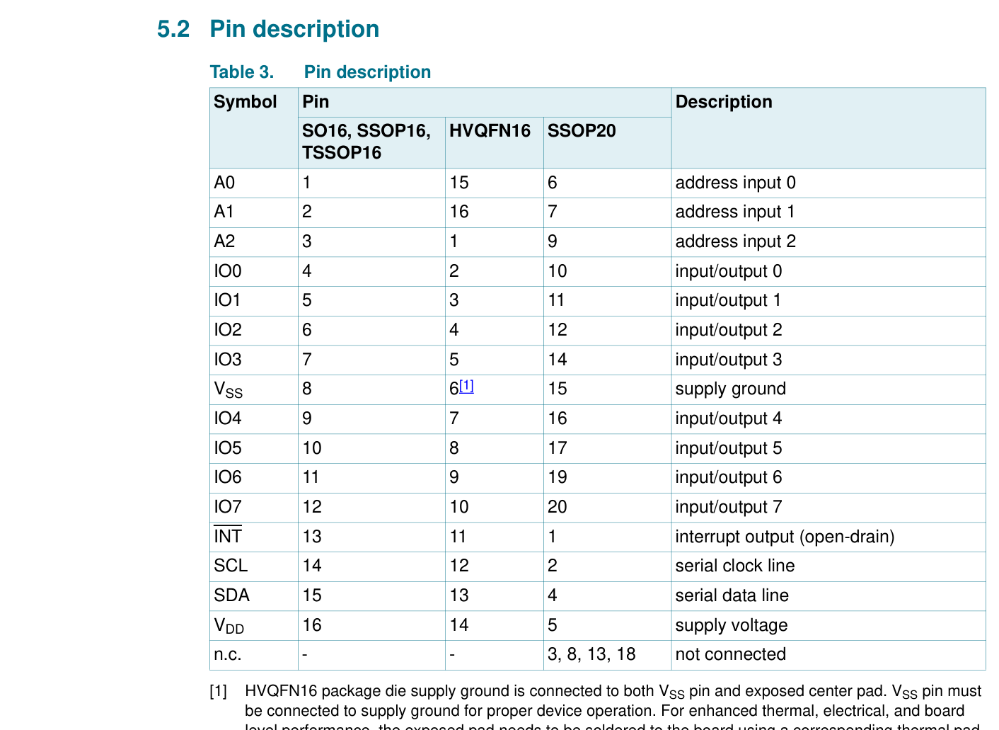
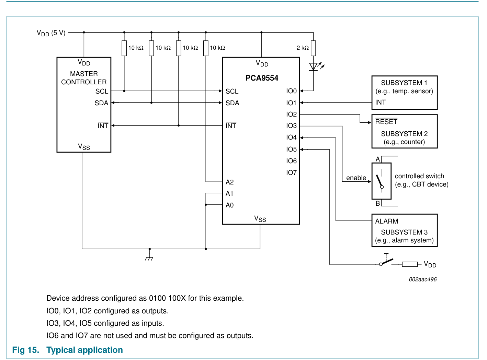
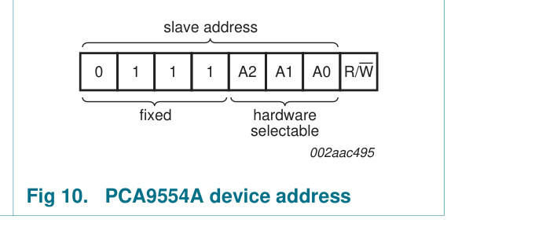

# Reference — PCA9554APW

**Datasheet:** NXP *PCA9554; PCA9554A*, Rev. 10, 8 November 2017 — `Datasheet/PCA9554_9554A.pdf`

---

## 1. Hardware

### 1.1 Pins — Table 3 (p.6)

|  Pin | Symbol  | Net on D1                                |     |
| ---: | ------- | ---------------------------------------- | --- |
|    1 | A0      | GND                                      |     |
|    2 | A1      | GND                                      |     |
|    3 | A2      | GND                                      |     |
|    4 | IO0     | `R3` **220 Ω** → `CAN_EN_L2`             |     |
|    5 | IO1     | `R4` **220 Ω** → `CAN_EN_L3`             |     |
|    6 | IO2     | `R5` **220 Ω** → `CAN_EN_L4`             |     |
|    7 | IO3     | NC                                       |     |
|    8 | VSS     | GND                                      |     |
| 9–12 | IO4–IO7 | NC                                       |     |
|   13 | INT     | NC                                       |     |
|   14 | SCL     | `SCL`                                    |     |
|   15 | SDA     | `SDA`                                    |     |
|   16 | VDD     | `+3V3` via `F9`; `C6` 100 nF, `C7` 10 µF |     |

### 1.2 Design decisions — Fig 15 (p.12)

| Item | Datasheet | Used | Why |
|---|---|---|---|
| Address | Fig 10: fixed `0111` + A2–A0; static inputs, I_LI ±1 µA (Table 10) | **A0–A2 → GND** | `0111 000` = **0x38**; 1 µA across a trace ≈ 0 V, so no resistors |
| I²C pull-up | Fast mode: t_r ≤ 300 ns (Table 11) | **2.2 kΩ** to +3V3, on L1 only | 0.847 × 2.2 kΩ × 100 pF = **186 ns** < 300 ns; one pull-up point per bus |
| CAN_EN series resistor | each I/O ≤ 25 mA external (Table 10 note 2); §6.4: low-impedance path to VDD/VSS when driven | **220 Ω** (`R3`–`R5`) | 3.3 V / 25 mA = **132 Ω** minimum; 3.3 V / 220 Ω = **15 mA**; 3 × 15 = 45 mA < 100 mA |
| CAN_EN pull-up | reset: Output = 0xFF, Configuration = 0xFF (Tables 6, 8); input pull-up 100 kΩ | **4.7 kΩ** (`R6B`–`R8B`) | high: 3.3 × 47 / (4.7 + 47) = **3.0 V** > V_IH 2.0 V (CWV 47 kΩ pulldown); low: 0.70 mA × 220 Ω = **0.15 V** < V_IL 0.8 V |
| Unused I/O | Fig 15: IO6, IO7 "must be configured as outputs" | IO3–IO7 NC | firmware **C3–C7 = 0**; as inputs they sit on the 100 kΩ pull-up |
| INT | open-drain (Table 3) | NC | not used |

---

## 2. Software interface

### 2.1 Address and bus

| Item | Value |
|---|---|
| 7-bit address | **0x38** (write 0x70, read 0x71) |
| Master | L1 Pi I²C1 — GPIO2 = SDA, GPIO3 = SCL |
| Speed | up to 400 kHz |
| Pull-ups | 2.2 kΩ to +3V3, on L1 only |
| INT | not connected |

### 2.2 Registers

| Command byte | Register | Access | Reset value |
|---:|---|---|---|
| 0x00 | Input port | read | pin levels |
| 0x01 | Output port | read/write | 0xFF |
| 0x02 | Polarity inversion | read/write | 0x00 |
| 0x03 | Configuration | read/write | 0xFF (all inputs) |

No auto-increment: send the command byte before each register access (§6.6).

### 2.3 Bit map

| Bit | Pin | Net | Function |
|---:|---|---|---|
| 0 | IO0 | `CAN_EN_L2` | **0 = enabled, 1 = isolated** |
| 1 | IO1 | `CAN_EN_L3` | same |
| 2 | IO2 | `CAN_EN_L4` | same |
| 3–7 | IO3–IO7 | NC | must be outputs |

### 2.4 Initialisation

1. `Configuration = 0x00` — all pins outputs (Fig 15 requires unused I/O to be outputs). Output register already 0xFF → all `CAN_EN` high = isolated.
2. `Output = 0xFF` — optional, reset value.
3. Enable layer *n*: `Output = 0xFF & ~(1 << n)`.
