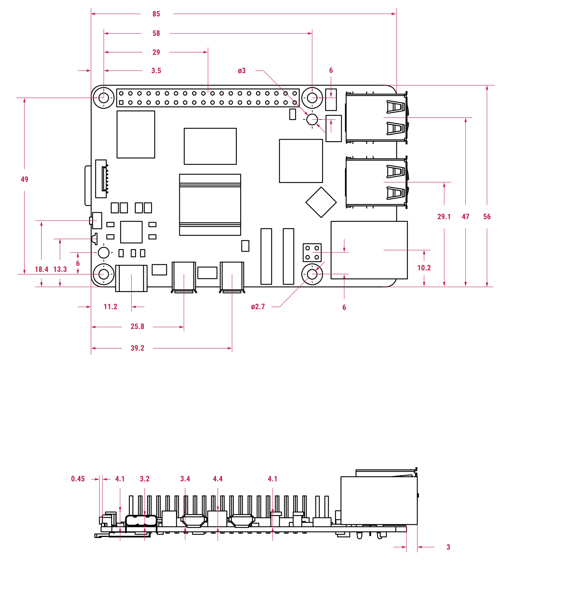

# Reference — Raspberry Pi 5 (Pi layer)

**Sources:** `research_raw/pi5/pi5_brief.pdf` (Product Brief, Oct 2026) · `pi5_mech.pdf` (mechanical drawing) · `hat_plus_specification.pdf` (HAT+ spec, 2024-12-05) · `pi5_pcie_connector_datasheet.pdf` (2024-01-15) · `active_cooler_mechanical_drawing.pdf` · `cable_reference_drawing.pdf`.


---

## 1 Hardware

### 1.1 Pi 5 board — Product Brief p.2–3

| Item | Value |
|---|---|
| SoC | BCM2712, 4× Cortex-A76 @ 2.4 GHz, 2 MB shared L3 |
| RAM | LPDDR4X-4267, 1 / 2 / 4 / 8 / 16 GB |
| Wireless | dual-band 802.11ac, Bluetooth 5.0 / BLE |
| USB | 2× USB 3.0 (5 Gbps) + 2× USB 2.0 |
| Ethernet | Gigabit, PoE+ (separate PoE+ HAT) |
| Camera / display | 2× 4-lane MIPI |
| PCIe | 2.0 ×1 |
| Power | **5 V / 5 A** via USB-C, Power Delivery |
| Header | standard **40-pin** GPIO |
| Other | RTC (external battery), power button |
| Temperature | 0–70 °C |
| Lifetime | in production until at least Jan 2036 |

### 1.2 Mechanical — `pi5_mech.pdf`



| Item | Value |
|---|---|
| Board | **85 × 56 mm** |
| Mounting holes | **4× Ø2.7 mm**, array **58 × 49 mm** |
| Hole datum | centers **3.5 mm** from the left and top edges; right holes **23.5 mm** from the right edge (85 − 3.5 − 58) — **not symmetric** |
| 40-pin header | 2×20, **2.54 mm** pitch, along the top edge; centre **32.5 mm** from the left edge (3.5 + 29) ⇒ pin 1 ≈ **8.4 mm**, pin 20 ≈ **56.6 mm** |
| Edge connectors | USB / Ethernet on the right edge, overhanging the board |
| Component height | 3.2–4.4 mm above the PCB (side view) |
| Active Cooler | **63.5 × 42.5 × 13.7 mm**, 30 mm fan |
| Camera / display FPC | 15-pin **1.0 mm** or 22-pin **0.5 mm**; standard cable **200 mm**, widths **16 / 11.5 mm** |
| PCIe FFC | **16-pin, 0.5 mm** pitch; 5 V on pins 1/2, **500 mA each** (1 A total); FFC **≤50 mm**, **90 Ω ±10 %**, opposite-side contacts |

The header is **left-of-centre**; pin 1 is at the left end. The four holes are a rectangle offset to the left — place them from these datums, not from the board centre.

### 1.3 40-pin header electrical — HAT+ spec p.4–7, 12–13

| Item | Value |
|---|---|
| Header | 2×20, 0.1 in (2.54 mm), 28 GPIO |
| Logic | **3.3 V** digital I/O, programmable pulls |
| Power pins | 5 V on **2 / 4**; 3.3 V on **1 / 17**; GND on 6/9/14/20/25/30/34/39 |
| Power-on state | all GPIO inputs with a **weak pull-up or pull-down**; a board needing a defined level must add its own pull |
| GPIO2 / GPIO3 | on-board **≈2 kΩ** pull-ups to 3.3 V (Pi 5 board: 1.8 kΩ) |
| ID_SD / ID_SC (27 / 28) | **reserved**: only an ID EEPROM and its 3.9 kΩ pull-ups; nothing else |
| STANDBY | 5 V rail on, **3.3 V rail off**; add-on boards must tolerate this and must not assume rail sequencing |
| Power HAT+ | must supply **≥3 A at 5.1 V**, recommended **5 A**; MODE0/1 signalled by the ID EEPROM |

The project board is **not a HAT+** (no ID EEPROM, mounted under the Pi), but the header rules above still apply.

### 1.4 Project `J_PI` usage — `10` §4.1.2

| Pi pin | GPIO | Net | Dir | Use |
|---:|---|---|---|---|
| 1, 17 | 3V3 | **NC** | — | `PI_3V3` not connected to system `+3V3` |
| 2, 4 | 5V | `+5V_PI` | → Pi | main 5 V, 4 A design |
| 6, 9, 14, 20, 25, 30, 34, 39 | GND | GND | — | |
| 3 | GPIO2 | `SDA` | ↔ | I²C1; 2.2 kΩ board + 1.8 kΩ Pi ≈ 0.99 kΩ |
| 5 | GPIO3 | `SCL` | ↔ | I²C1; same pull-up |
| 8, 10 | GPIO14/15 | `RSV_UART_TX/RX` | ↔ | → `TP18` / `TP19` |
| 19 | GPIO10 | `SPI_MOSI` | → MCP2515 | |
| 21 | GPIO9 | `SPI_MISO` | ← MCP2515 | |
| 23 | GPIO11 | `SPI_SCK` | → MCP2515 | |
| 24 | GPIO8 | `SPI_CS` | → MCP2515 | |
| 22 | GPIO25 | `CAN_INT` | ← MCP2515 | 4.7 kΩ pull-up to +3V3 |
| 18 | GPIO24 | `CAN_RST` | → MCP2515 | 10 kΩ pull-up to +3V3 |
| 11 | GPIO17 | `IMU_INT` | ← LSM6DSO | GPIO9–27 reset pull-down |
| 32 | GPIO12 | `MAG_ISO` | → Q2/Q3 | 100 kΩ pull-down; high = magnetometer connected |
| 33 | GPIO13 | `WDI` | → TPS3813 | 100 kΩ pull-down |
| 7 | GPIO4 | **NC** | — | reset pull-up; 1-Wire default |
| 27, 28 | ID_SD/ID_SC | **NC** | — | reserved |
| 12, 13, 15, 16, 26, 29, 31, 35, 36, 37, 38, 40 | GPIO18/27/22/23/7/5/6/19/16/26/20/21 | `RSV_*` | — | spare |

## 2 Integration

### 2.1 Power

```
XT30 (J_5V, 4 A) → F21 5 A → Q1 → R20 5 mΩ → +5V_PI → J_PI pins 2/4
                                      │
                              C20 470 µF + C21 100 nF → GND
```

- Raspberry Pi's official 27 W supply is **5.1 V / 5 A**; a Power HAT+ must give **≥3 A at 5.1 V** (5 A recommended). The project is **5.0 V / 4 A** — at the low end of the voltage window; check for undervoltage with the Pi + Active Cooler.
- **Do not connect USB-C power while the XT30 is live** — the board has no OR-ing on `+5V_PI`.
- `PI_3V3` (pins 1/17) is **not** connected to the system `+3V3`; the two regulators must not fight.
- INA226 (`U3`) measures the 5 V bus; `R20` is in the main path, not a shunt to ground.

### 2.2 Signal levels

- All GPIO are **3.3 V**; do not apply 5 V to any pin.
- I²C: 2.2 kΩ on L1 ∥ Pi 1.8 kΩ ≈ **0.99 kΩ**, 400 kHz.
- SPI: MCP2515, **≤8 MHz** (device max 10 MHz).
- External pulls fitted where a power-on level matters: `CAN_INT` 4.7 kΩ ↑, `CAN_RST` 10 kΩ ↑, `MAG_ISO` 100 kΩ ↓, `WDI` 100 kΩ ↓; `IMU_INT` relies on the GPIO9–27 reset pull-down (no resistor).

### 2.3 Mechanical stack

- Pi is **hung under L1**: 2×20 **long-pin female socket on the L1 bottom**; the Pi's pre-soldered header points up into it.
- **4× M2.5 standoffs** at the Pi **58 × 49** hole array carry the mechanical load; the 40-pin header must not.
- Clearance below L1: **≥22 mm** for the Active Cooler stack (Active Cooler 13.7 mm + thermal pad ≈1 mm + heat spreader 3 mm + margin) — `方案.md` §4.1, `F4` to measure.
- Heat spreader **90 × 70 × 3 mm** (6061-T6) hangs on 4× M2.5 from the L1 bottom; Ø5 mm hole array over the fan intake.
- Keep the **USB/Ethernet ports** (right edge), **camera/display FPC** and **PCIe FFC** accessible; the camera cable passes through a slot — `J_CAM` is not fitted.
- Bottom-side socket: **pin order is mirrored** relative to the top view; verify pin 1 against the physical board before layout.

## 3 Checks and notes

1. **`F5` can be closed** — the official drawing confirms **58 × 49 mm**, **Ø2.7 mm**; note the array is offset left (right holes 23.5 mm from the right edge), not centred.
2. **Header datum**: centre **32.5 mm** from the left edge, pin 1 ≈ **8.4 mm**; use this to place the bottom socket.
3. **Document error in `10` §4.3**: “Pi 元件面朝上、离 L1 板底面 ≥ 2.4 mm” — 2.4 mm is the clearance **above** L1 (`方案.md` §3.1); the Pi side needs **≥22 mm** (`方案.md` §4.1). Fix `10` §4.3.
4. **Power**: 5.0 V / 4 A vs the official 5.1 V / 5 A — verify no undervoltage with the Pi + Active Cooler + camera; do not backfeed USB-C.
5. **ID pins 27/28 and `PI_3V3` 1/17 are NC** — correct; do not add a HAT+ EEPROM.
6. **STANDBY** (5 V on, 3.3 V off): L1's `+3V3` stays live and would drive unpowered Pi pins — add isolation if STANDBY is ever used; the L1 design otherwise assumes WARM-STANDBY.
7. **PCIe** is unused; keep the 16-pin FFC accessible in case an M.2 HAT is added later.
8. **Active Cooler** is 13.7 mm tall — confirm the `F4` stack height before fixing the L1 layer height.
9. **`10` §4.1.2 table is stale for pins 32/33**: it still lists them under `RSV_*`, but the netlist has `MAG_ISO` on `J_PI.32` and `WDI` on `J_PI.33` (`eda/D3a_L1_power_netlist.txt`). Add the two rows and drop them from the spare list.
