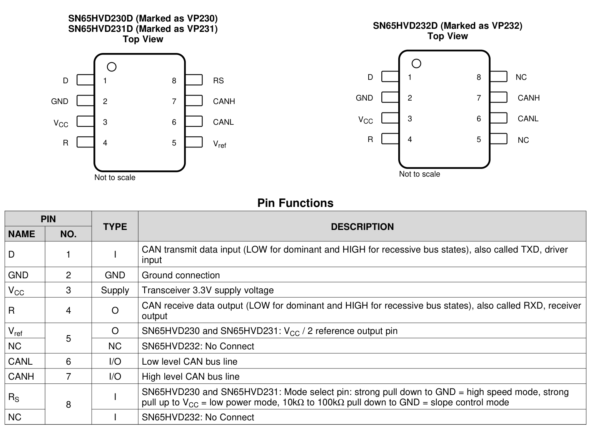
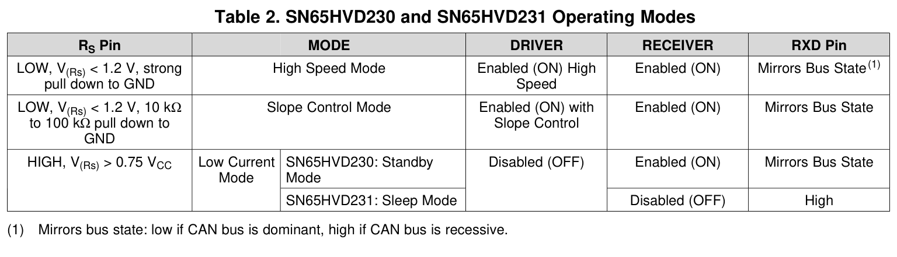
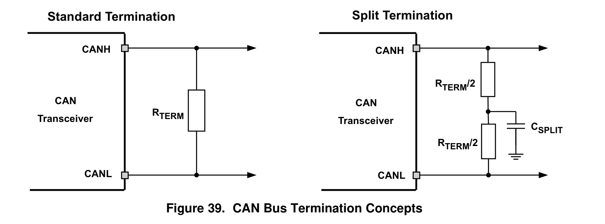

# Reference — SN65HVD230

**Datasheet:** Texas Instruments *SN65HVD230, SN65HVD231, SN65HVD232 — 3.3-V CAN Bus Transceivers*, SLOS346O (March 2001, revised April 2018) — `Datasheet/SN65HVD230DR.pdf`

---

## 1. Hardware

### 1.1 Pins — Pin Functions (p.5)

|  Pin | Symbol | Net on D3b | Note |
| ---: | ------ | ---------- | ---- |
|    1 | D      | `CAN_TXD`  | ← `U1.1` TXCAN; **low = dominant** |
|    2 | GND    | GND        | |
|    3 | VCC    | `+3V3`     | `C26` 100 nF to GND |
|    4 | R      | `CAN_RXD`  | → `U1.2` RXCAN; mirrors the bus |
|    5 | Vref   | NC         | VCC/2 output; may be left floating (§10.3.1) |
|    6 | CANL   | `CANL`     | |
|    7 | CANH   | `CANH`     | |
|    8 | RS     | `RS_PIN`   | `R24` **0 Ω** → GND = high-speed mode |

Only the SN65HVD230 is used. The SN65HVD231 replaces standby with sleep; the SN65HVD232 has no RS or Vref pin (Device Comparison Table, p.4).

### 1.2 Design decisions — Table 2 (p.23), §10.3, §11–§13

| Item | Datasheet | Used | Why |
|---|---|---|---|
| Supply | VCC 3.0–3.6 V (§8.3, p.6) | **3.3 V** | within range |
| Data rate | up to **1 Mbit/s** | **500 kbit/s** | 2× margin; MCP2515 bit timing = 8 TQ |
| Mode | RS < 1.2 V, strong pull-down = high speed (Table 2) | **`R24` 0 Ω to GND** | no slope control needed at 500 kbit/s |
| Logic levels | V_IH = 2.0 V, V_IL = 0.8 V; D low = dominant, R mirrors (Tables 3/4, §8.3) | direct to MCP2515 TXCAN/RXCAN | 3.3 V CMOS compatible |
| Vref | VCC/2 output; **may be left floating if unused** (§10.3.1) | **NC** | split termination is AC-grounded through `C24` |
| Decoupling | 100 nF ceramic close to VCC/GND (§12, p.32) | **`C26` 100 nF** | required by the datasheet |
| Bus protection | external TVS recommended for ESD/EFT/surge (§11.2.2, p.29) | **`D22` PESD1CAN**, CANH–CANL–GND | ±16 kV HBM on-chip is not a system-level surge rating |
| Termination | 120 Ω at each bus end; split = 2 × 60 Ω + C to GND (Fig 39, p.27) | **`R22`/`R23` 60.1 Ω + `C24` 4.7 nF**, via `JP21` | matches Fig 39; CWV side has no termination (`09` §13.13) |
| Loop delay | RS = 0: 70/100 ns typ, 115/135 ns max (§8.9, p.8) | 500 kbit/s → 2000 ns/bit | ≤ 7 % of a bit |
| Common mode | −2 V to +7 V; ±25 V transient (p.4, §8.3) | short internal bus | large margin |
| Open-circuit fail-safe | open bus → R = high (§10.3, p.20) | — | no false dominant on a broken bus |
| Hot plug | bus pins high-Z while unpowered (§10.3, p.20) | — | unpowered node does not load the bus |
| Thermal shutdown | 165 °C; receiver stays active (§10.3.2) | — | protection only |
| Standby | RS > 0.75 VCC: driver off, receiver on (Table 2) | **not used** | `R24` fixed to GND; see note below |
| Bus loading | up to 120 transceivers; ISO 40 m, 0.3 m stub, 30 nodes (§11.2.1.3) | short stack | far inside the limits |

**Checks and notes**

- Pinout, supply, mode, decoupling, TVS and termination all match the datasheet. **No connection error found.**
- `Vref` floating is explicitly allowed. If common-mode filtering is wanted later, tie pin 5 to the `R22`/`R23` centre; do **not** add a 100 nF from Vref to GND.
- With `R24` = 0 Ω, firmware cannot use standby / babbling-idiot protection. To use it, replace `R24` with a GPIO or a resistor. Not required for L1.
- Termination resistors: a 5 V fault across the pair gives ≈ **0.10 W** per 60.1 Ω resistor; if the split centre shorts to ground, ≈ **0.42 W**. Specify **≥ 0.25 W (1206)** (§11.2.1.1 warns about this).
- Place `D22` close to `U2` (the common CANH/CANL node), **not** at one card-edge: one TVS cannot cover both the EL and ER entries from one edge. Keep the `R22`/`R23`/`C24` split-termination network with `D22` at `U2`, and `C26` at U2 pins 3/2 (§13.1, p.33).

---

## 2. Interface

### 2.1 Logic states — Tables 3/4 (p.23)

| D (TXD) | Bus | R (RXD) |
|---|---|---|
| L | dominant | L |
| H | recessive | H |
| open | recessive | H |
| — | open bus | H |

`R` is a push-pull output; no pull-up is needed. MCP2515 TXCAN/RXCAN use the same polarity (low = dominant).

### 2.2 Mode selection — Table 2 (p.23)

| RS | Mode | Driver | Receiver |
|---|---|---|---|
| < 1.2 V, strong pull-down | **High speed** | on | on |
| 10–100 kΩ to GND | Slope control | on, limited slew | on |
| > 0.75 VCC | Standby (230) | **off** | on |

Used: **high speed**, `RS` = 0 V.

### 2.3 Timing at 500 kbit/s

- Bit time = **2000 ns**; MCP2515 sample point = 62.5 % → 1250 ns.
- Transceiver loop delay (RS = 0): **70/100 ns typ**, **115/135 ns max** per direction — about 7 % of a bit.
- Driver rise/fall at RS = 0: 25–100 ns / 40–80 ns, well inside the bit.

### 2.4 Bring-up checks

1. Power: `U2.3` = 3.3 V, `U2.8` = 0 V (high-speed mode).
2. Board unpowered: CANH/CANL should be high-Z and must not load the bus.
3. Recessive: CANH and CANL ≈ VCC/2 = **1.65 V**; dominant: CANH − CANL ≥ **1.5 V**.
4. Transmit a frame from the MCP2515; verify dominant/recessive levels at `EL.4`/`EL.5`.
5. If the bus stays dominant, check `U2.1` (TXD) is not stuck low — this part has **no automatic TXD dominant timeout**.
