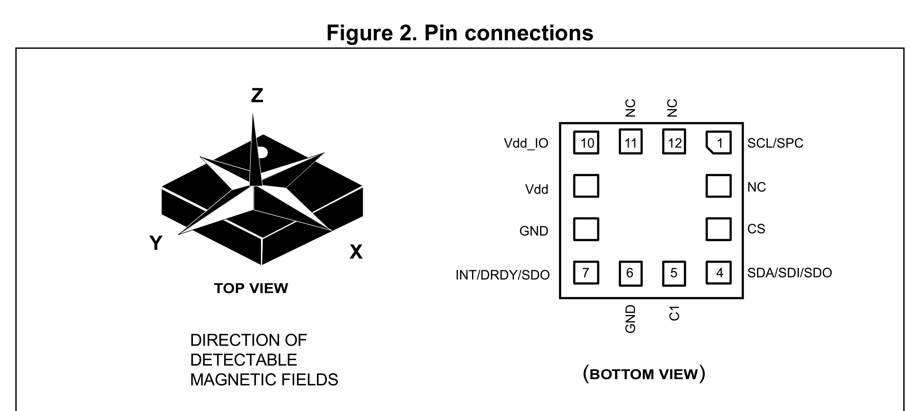
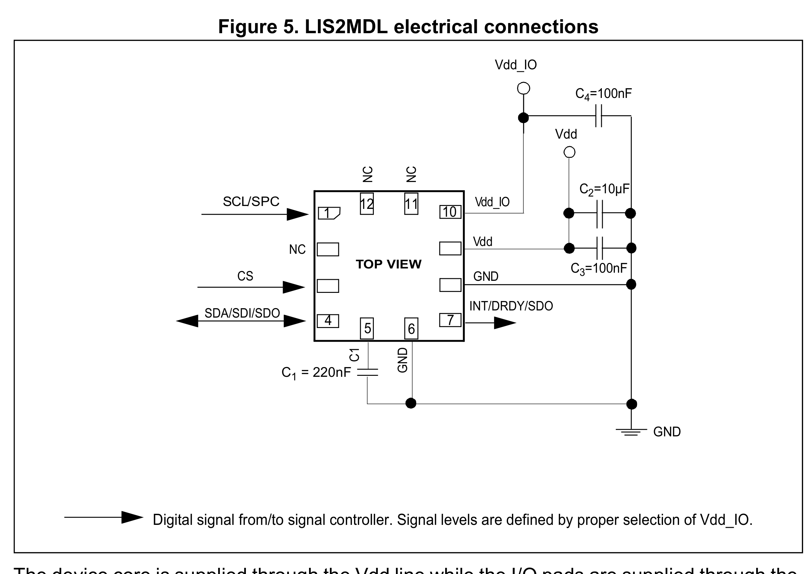
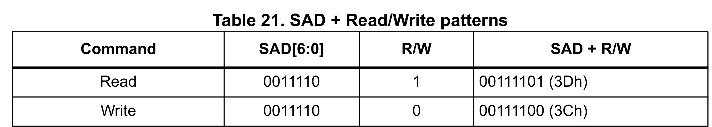

# Reference — LIS2MDL

**Purpose:** verify the D7 magnetometer against the datasheet; document the I²C configuration, the mandatory C1 capacitor and the bring-up checks.

**Datasheet:** ST *LIS2MDL — 3-axis magnetometer*, DocID030621 Rev 5 — `Datasheet/LIS2MDLTR.pdf`
**Part:** LIS2MDLTR (LCSC C919695; LGA-12L, 2.0 × 2.0 × 0.7 mm). Board D7, `U1` — I²C `0x1E`.
**Board sheet:** `10_原理图.md` §4.4; netlist `eda/D7_mag_board_netlist.txt`.

---

## 1. Hardware

### 1.1 Pins — Figure 2 (p.7), Table 2 (p.8)



| Pin | Name | Net on D7 | Note |
| ---: | ---- | --------- | ---- |
| 1 | SCL/SPC | `MAG_SCL` | I²C clock |
| 2 | NC | — | may be tied to Vdd, Vdd_IO or GND; left open |
| 3 | CS | `+3V3` | **high = I²C**; no internal pull-up — must not float |
| 4 | SDA/SDI/SDO | `MAG_SDA` | I²C data |
| 5 | C1 | `MAG_C1` | **220 nF to GND** — charge-pump capacitor, mandatory |
| 6 | GND | GND | |
| 7 | INT/DRDY/SDO | NC | default high-Z; push-pull if `DRDY_on_PIN`/`INT_on_PIN` set |
| 8 | GND | GND | |
| 9 | Vdd | `+3V3` | core supply |
| 10 | Vdd_IO | `+3V3` | I/O supply |
| 11 | NC | — | may be tied to Vdd, Vdd_IO or GND; left open |
| 12 | NC | — | may be tied to Vdd, Vdd_IO or GND; left open |

Only I²C is used (`CS` high). There is no SA0 pin; the address is fixed.

### 1.2 Design decisions — Figure 5 (p.19), Table 5 (p.10), Table 2 (p.8)



| Item | Datasheet | Used | Why |
|---|---|---|---|
| Supply | Vdd **1.71–3.6 V**; Vdd_IO **1.71–3.6 V** (Table 5) | **3.3 V** on both | within range |
| Interface | CS **high** = I²C; CS low = SPI (§5, Table 2) | **I²C**, `CS` = +3V3 | SPI not needed |
| Address | fixed `0011110b` = **0x1E** (Table 21, p.24) | — | no SA0 pin |
| I²C speed | up to 3.4 MHz (p.22); fast mode 400 kHz (Table 7) | **400 kHz** | Pi I²C1 |
| Pull-ups | external to Vdd_IO (p.22) | `R27`/`R28` 2.2 kΩ + Pi 1.8 kΩ on the **L1 side** of `Q2`/`Q3` | see §1.3 |
| C1 | **220 nF**, low ESR ≤ 200 mΩ, close to pins 5/6 (§5, p.19) | `C1` **220 nF** | mandatory — no C1, no measurement |
| Decoupling | **100 nF + 10 µF** near pin 9; 100 nF on Vdd_IO (Fig 5) | `C2` **100 nF** (shared rail) | 10 µF not fitted — see §1.3 |
| INT | pin 7 default **high-Z** (Table 14); push-pull if enabled | NC | polling; keep `DRDY_on_PIN`/`INT_on_PIN` = 0 |
| Range / LSB | ±49.152 gauss; 1.5 mgauss/LSB = **0.15 µT/LSB** (Table 3) | — | Earth field 25–65 µT |
| Current | 200 µA HR @ 20 Hz; 1.5 µA power-down (Table 5) | — | negligible on the 3.3 V rail |
| Package | LGA-12L, 2.0 × 2.0 × 0.7 mm (p.37) | — | |

### 1.3 Checks and notes

**No connection error found.** Pinout, CS strapping, address, C1 and the NC pins all match DocID030621 Rev 5.

#### ⚠️ Decoupling — the 10 µF is not fitted

Figure 5 and §5 (p.19): "Power supply decoupling capacitors (100 nF ceramic, 10 µF aluminum) should be placed as near as possible to pin 9". D7 fits only `C2` 100 nF; the nearest bulk is `C27` 10 µF on L1, at the far end of the ~100 mm cable. For a 200 µA sensor the 100 nF covers the average current and `C1` covers the charge-pump pulses, so this is **not** a functional blocker. **Recommended:** add a 10 µF on D7 (space is available) to follow the datasheet.

#### ⚠️ Pull-ups sit on the L1 side of the isolator

The datasheet requires external pull-ups to Vdd_IO. D7 has none: the only pull-ups are `R27`/`R28` 2.2 kΩ to +3V3 on D3b, in parallel with the Pi 5's fixed 1.8 kΩ (≈ 0.99 kΩ), on the **main-bus side** of `Q2`/`Q3`.

- Mag-side **high**: supplied through the `Q2`/`Q3` body diode (S → D); at the LIS2MDL input leakage it settles at ≈ **2.9–3.0 V**. V_IH = 0.7 × 3.3 = **2.31 V** → OK.
- Mag-side **low**: the LIS2MDL pulls `MAG_SDA` to V_OL ≈ 0.2 V; the main side sees V_OL + V_F(body diode) ≈ **0.8 V**. V_IL = 0.3 × 3.3 = **0.99 V** → within spec, but the margin is only ≈ 0.2 V.
- A single pass FET always puts the body diode in the mag → main low path; this cannot be avoided by changing the gate. Verify the ACK at bring-up. If it is marginal, removing `R27`/`R28` lowers the pull-up current (1.8 kΩ alone) and therefore the diode drop, at the cost of a slower rise time.

#### C1 — 220 nF, low ESR

`C1` is **mandatory** and must be **220 nF**; the datasheet also requires **low ESR (max 200 mΩ)** and placement as close as possible to pins 5 and 6 because "very high current pulses flow from C1 to pin 5 and 6" (§5, p.19). Specify a low-ESR X7R/X5R 0603/0805 and keep the loop tiny.

#### Pin 7 (INT/DRDY)

Pin 7 defaults to **high impedance** (Table 14, p.20); NC is correct. In software keep `DRDY_on_PIN` = 0 and `INT_on_PIN` = 0 in `CFG_REG_C` (62h), and `4WSPI` = 0; otherwise the pin becomes a push-pull output. If a data-ready interrupt is wanted later, add a test pad — a wire cannot practically be soldered to a 0.2 mm LGA pad.

#### Other notes

- `COMP_TEMP_EN` in `CFG_REG_A` (60h) **must be 1** for proper operation (Table 24).
- The device powers up in **idle mode** (MD = 11) at 10 Hz; write `CFG_REG_A = 0x80` to start continuous high-resolution conversion with temperature compensation.
- `OFFSET_X/Y/Z_REG` (45h–4Ah) provide a hardware hard-iron offset; they can complement the 8-figure calibration in `方案.md` §9.2.
- §5.2 (p.21): keep conductors carrying > 10 mA a few mm away from the sensor.
- `WHO_AM_I` (4Fh) = **0x40**.
- Absolute maximum: Vdd/Vdd_IO 4.8 V; any input −0.3 to Vdd_IO + 0.3 V (Table 9, p.14).

### 1.4 Bring-up checks

1. Power: `U1.9` (Vdd) = `U1.10` (Vdd_IO) = **3.3 V**; `C1` close to pins 5/6.
2. `CS` (`U1.3`) = **3.3 V** — if it floats low the device is in SPI mode and will not ACK.
3. `MAG_ISO` (Pi GPIO12) = **high** — `Q2`/`Q3` must be on.
4. `i2cdetect -y 1` shows **0x1E**; read `WHO_AM_I` (0x4F) = **0x40**.
5. Write `CFG_REG_A` (0x60) = **0x80** (temp comp, 10 Hz HR continuous).
6. Read `STATUS_REG` (0x67) until `Zyxda` = 1; read `OUTX/Y/Z` (0x68–0x6D), two's complement, 1.5 mgauss/LSB.
7. If the ACK is marginal, check the main-side `MAG_SDA` low (§1.3); if it is close to V_IL, remove `R27`/`R28` and retest.

---

## 2. Interface

### 2.1 I²C address and timing — Table 21 (p.24), Table 7 (p.12)



| Item | Value |
|---|---|
| 7-bit address | **0x1E** (`0011110b`) |
| Write byte | **0x3C** |
| Read byte | **0x3D** |
| Max clock | fast mode **400 kHz** (device supports up to 3.4 MHz) |
| WHO_AM_I (0x4F) | **0x40** |
| Auto-increment | SUB MSB = 1 |

A read uses `START → SAD+W → SUB → repeated START → SAD+R → data → NACK → STOP`.

### 2.2 Register quick reference — Table 22 (p.27)

| Register | Address | Default | Use |
|---|---:|---|---|
| `OFFSET_X/Y/Z` | 0x45–0x4A | 0x00 | hard-iron offset |
| `WHO_AM_I` | 0x4F | **0x40** | fixed |
| `CFG_REG_A` | 0x60 | 0x03 | ODR, mode, temp comp |
| `CFG_REG_B` | 0x61 | 0x00 | offset cancel, LPF |
| `CFG_REG_C` | 0x62 | 0x00 | BDU, pin 7, 4WSPI |
| `INT_CTRL_REG` | 0x63 | 0xE0 | interrupt enables |
| `INT_SOURCE_REG` | 0x64 | — | interrupt source |
| `INT_THS_L/H` | 0x65/0x66 | 0x00 | threshold |
| `STATUS_REG` | 0x67 | — | `Zyxda` (bit 3) = data ready |
| `OUTX_L/H` | 0x68/0x69 | — | X |
| `OUTY_L/H` | 0x6A/0x6B | — | Y |
| `OUTZ_L/H` | 0x6C/0x6D | — | Z |
| `TEMP_OUT_L/H` | 0x6E/0x6F | — | 8 digit/°C |

`CFG_REG_A` (60h): `COMP_TEMP_EN` **must be 1**; `MD[1:0]` = 00 continuous, 01 single, 10/11 idle; `ODR[1:0]` = 00 10 Hz, 01 20 Hz, 10 50 Hz, 11 100 Hz.
`CFG_REG_C` (62h): keep `4WSPI` = 0 and `DRDY_on_PIN` = `INT_on_PIN` = 0 (pin 7 NC); `BDU` = 1 for coherent reads.

Minimal probe sequence:

```
read  0x4F              -> 0x40
write 0x60 = 0x80       -> temp comp, 10 Hz HR continuous
write 0x62 = 0x10       -> BDU = 1 (optional)
read  0x67              -> wait Zyxda (bit 3)
read  0x68..0x6D        -> X/Y/Z, two's complement
```

### 2.3 Pi 5 side

| Signal | Pi pin | GPIO | Note |
|---|---:|---:|---|
| `SDA` | 3 | GPIO2 | Pi 1.8 kΩ + `R27` 2.2 kΩ → ≈ 0.99 kΩ |
| `SCL` | 5 | GPIO3 | Pi 1.8 kΩ + `R28` 2.2 kΩ → ≈ 0.99 kΩ |
| `MAG_ISO` | 32 | GPIO12 | output; **high = magnetometer connected**; `R29` 100 kΩ pulls it low at power-up |

`MAG_SDA`/`MAG_SCL` leave through `J_MAG` (JST-SH 4P) and reach D7 `J1` with the same pin order.
